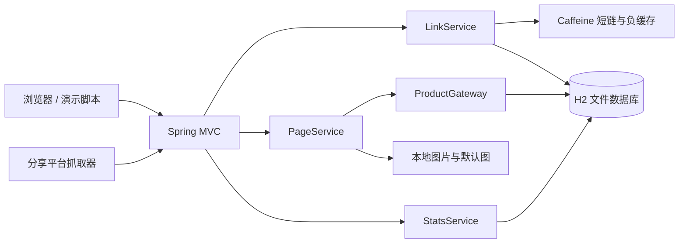

# 商品短链 / 分享卡片服务 Demo 实现方案

> 创建日期：2026-11-13；实施完成日期：2026-11-17。状态：Demo 已实现；下文保留原设计和任务拆分，实际运行方式以 README.md 为准，验证结果见 docs/validation.md。
> 本次按计划完成实现、测试和审查。实现细节调整见 docs/decisions.md，完整会话可见消息见 docs/prompts/conversation.md。
> 2026-11-17复核：逐项结果见 docs/REQUIREMENTS_AUDIT.md。第12节复选框保留原计划，不作为实时完成状态；后续追加页面工作台见 docs/WORKBENCH_PLAN.md，其同源外部脚本及CSP策略覆盖本方案早期“页面无需脚本”的范围假设。个人面试排练未代为确认。

**目标：** 在 4–6 小时内完成可一条命令启动的 Java Demo，覆盖生成短链、商品跳转、分享预览、访问统计和商品失效降级，并提供可复现的异常演示与工程证据。

**架构：** 单个 Spring Boot 服务承载 API 与服务端 HTML；H2 文件数据库持久化商品、短链和有效访问事件；Caffeine 提供有界短链缓存、负缓存与限流状态。商品系统用本地适配器模拟，保留接入外部商品服务的边界。

**技术栈：** Java 17、Spring Boot 3.x（固定为 3.5.7）、Maven Wrapper、Spring MVC、Spring JDBC、Thymeleaf、H2、Caffeine、JUnit 5、jqwik。Spring Boot BOM 管理常规依赖，jqwik 固定为 1.9.3；实施时确认依赖可解析，禁止使用 `LATEST` 或版本范围。构建配置设置 `java.version=17` 和编译目标 `release=17`，开发与验收均使用 JDK 17，不使用预览特性或更高版本专属 API。

**设计依据：** 本文第 1–10 节为设计，第 11–14 节为实施、验收与交付计划。实际 Git 根目录是 `D:\Code\IdeaProject\short-link\short-link`。设计开始时仅有 IDE 配置；现已完成应用源码、测试、演示与交付文档。

## 1. 范围与完成标准

### 1.1 必须完成的闭环

1. 指定商品、分享人、渠道创建短链；相同组合重复创建返回同一条短链。
2. 访问跳转入口，校验商品状态并返回 302 到本服务的模拟商品页。
3. 访问分享入口，返回首屏 HTML 中可直接读取的 Open Graph 元数据。
4. 有效点击产生可持久化的访问事件，支持 PV / UV 及渠道、分享人分组查询。
5. 不存在的短链、商品下架、商品删除、标题缺失、图片缺失均有确定行为。
6. 一条命令启动，一条命令演示主流程和异常路径，核心逻辑可脱离 Spring 容器测试。

### 1.2 主动限制工作量

- 单体、单实例、单数据库；不引入 Redis、消息队列、微服务、前端工程、分布式 ID 服务。
- 用预置商品与 Demo 管理接口模拟商品上下架和删除，不接真实电商平台。
- 商品图片采用项目内置资源，不实现任意外部 URL 图片代理。
- 不做登录系统、管理后台、用户自定义短码、短链过期、支付、订单或真正的微信 SDK 集成。
- 分享人仅为归因字段，不声称完成真实身份校验；管理 API 使用 Demo Token。
- 不承诺“微信一定展示指定卡片”：Open Graph 是本项目的通用输出能力，微信端效果还受平台抓取策略、缓存及 JS-SDK 接入条件影响。

### 1.3 方案比较

| 方案 | 优点 | 代价 | 决策 |
| --- | --- | --- | --- |
| Spring Boot + H2 + Caffeine | Java 生态熟悉；无外置数据库；能完整展示一致性、缓存和测试 | 单实例，分析查询与在线业务共用数据库 | Demo 采用 |
| Spring Boot + PostgreSQL + Redis | 更接近多实例部署，具备共享缓存与限流能力 | 部署、迁移和故障面增加，挤占业务验收时间 | 后续演进 |
| 纯内存实现 | 最快完成 happy path | 重启丢数据，难说明统计与约束的可靠性 | 不采用 |

## 2. 架构与数据流



代码按职责组织，接口边界保持精简：

- `Base62Codec`：正整数与规范 Base62 字符串的互逆转换，无数据库和 Spring 依赖。
- `LinkService`：参数校验、业务去重、随机键生成、缓存查询；数据库负责最终唯一性。
- `ProductGateway`：`findById(long productId)` 返回当前商品或缺失；Demo 使用 JDBC 适配器。
- `PageService`：根据链接与商品状态形成页面模型，由 Thymeleaf 转义渲染。
- `StatsPolicy`：基于请求类型、访客标识、时间生成是否计数的决策，使用可注入的 `Clock`。
- `StatsService`：保存有效事件、处理重复计数、执行统计查询。
- `AbuseGuard`：全局与 IP 限流，位于数据库和负缓存之前。

### 2.1 创建短链

鉴权 → 校验请求 → 读取在售商品 → 查询业务组合 → 生成随机数并编码 → 插入数据库 → 返回两个 URL。不存在的商品返回 404，非在售商品返回 409。商品状态可能在创建后立即变化，因此所有访问入口仍重新检查商品状态。

### 2.2 跳转与分享预览分开

- `GET /s/{key}` 是跳转入口：解析短链 → 读取当前商品 → 记录有效点击 → 302 到 `/products/{id}`。
- `GET /c/{key}` 是分享卡片入口：解析短链 → 读取当前商品 → 返回包含 OG 标签的 HTML，页面提供“查看商品”链接，指向 `/s/{key}`。
- 创建接口同时返回 `shortUrl` 和 `shareUrl`；需要平台抓取预览时分享 `shareUrl`。
- 卡片页不自动跳转，不依赖 JavaScript 才生成元数据，不计入商品点击 PV；用户点击按钮时再计数。
- `HEAD /s/{key}` 保留相应状态码、Location 等响应头，但不写统计、不设置访客 Cookie；不能仅依赖框架隐式调用 GET 的默认行为。
- `/products/{id}` 只是落地页，不再次记短链点击；它也检查商品状态，处理跳转与落地之间商品下架的竞态。

这会增加一次用户点击，但能避免“平台抓卡片就是一次真实访问”的混淆。如果产品要求单 URL 同时自动跳转和预览，需另行设计爬虫识别或中间页，其误判与平台兼容成本不纳入 Demo。

## 3. 短链键、互逆性与重复创建

### 3.1 选择随机整数 + Base62

采用 `SecureRandom` 生成范围为 `[1, Long.MAX_VALUE]` 的正整数，然后做 Base62 编码。字母表固定为：

```text
0123456789ABCDEFGHIJKLMNOPQRSTUVWXYZabcdefghijklmnopqrstuvwxyz
```

- 编码结果长度 1–11，大小写敏感，不左补零；避免数据库使用忽略大小写的比较设置。
- 编码对象是随机数，解码只还原随机数，不直接还原商品 ID 或原始 URL；业务映射仍需查询数据库。
- 不使用自增 ID 直接编码，减少顺序枚举；不截断商品 URL 哈希，避免归因信息与 URL 规范化混在一起。
- 随机不是鉴权：任何拿到链接的人都可访问，短链不承载私密商品访问权限。
- 100 万条链接在约 `2^63` 空间中，生日碰撞概率约 `n(n-1)/(2N) ≈ 5.4×10^-8`；概率低仍必须依赖唯一约束。

### 3.2 编解码合同

接口：`String encode(long value)`、`long decode(String key)`。

1. `encode` 拒绝零和负数；对正数循环取模、除以 62，再反转字符。
2. `decode` 先判断 null、空串与长度上限，再逐字符解析，仅接受 ASCII 字母表内字符。
3. 拒绝空白、前后空格、正负号、中文、Emoji、标点、前导零以及单独的 `0`；不 trim，不纠错。
4. 每步更新前验证 `acc <= (Long.MAX_VALUE - digit) / 62`，防止溢出。
5. 满足 `decode(encode(n)) == n`；对所有被接受的规范 key，满足 `encode(decode(key)) == key`。
6. `%` 等字符在核心编解码函数中非法。HTTP 容器可能先做一次百分号解码，业务层不重复解码；畸形 URL 允许容器直接返回 400。

### 3.3 唯一性、冲突和幂等

- `short_link.key` 主键约束拦住随机碰撞；发生真正的 key 冲突时换随机数，最多总计尝试 3 次，仍失败返回 503 `KEY_GENERATION_EXHAUSTED`。
- `(product_id, sharer_id, channel)` 建立唯一约束。重复创建按业务幂等处理，首次返回 201，复用返回 200，`reused=true`。
- 并发创建同一组合时，唯一约束失败后先按业务组合重查；查到则返回已有链接，未查到且确认为 key 冲突才重试。
- 仅捕获已知唯一性异常；磁盘不可写、连接失败等不能伪装为碰撞。事务失败后在新事务中重查，避免在已回滚事务里继续执行。
- 暂不增加 `Idempotency-Key`：当前资源由固定三元组唯一决定，业务唯一约束已覆盖本 Demo 的重复提交。

## 4. 数据模型与持久化

使用 H2 文件模式 `jdbc:h2:file:./data/shortlink`，在项目根目录的 `data/` 下保存数据，启动前自动创建目录并检查可写性。`data/` 加入 `.gitignore`，不存放在会被 `mvn clean` 清除的 `target/` 中。关闭 H2 Web Console。初始化 SQL 只创建缺失表，种子数据仅在空库写入；正常重启不能覆盖用户修改的商品状态。统一从项目根目录启动，避免相对路径指向不同数据库；测试使用独立内存库或临时目录，不能操作演示数据文件。

| 表 | 字段 | 关键约束 / 索引 |
| --- | --- | --- |
| `product` | `id BIGINT`、`title VARCHAR(200)`、`description VARCHAR(500)`、`image_ref VARCHAR(100)`、`status VARCHAR(16)`、`updated_at TIMESTAMP WITH TIME ZONE` | 主键 `id`；status 为 `ACTIVE/OFF_SHELF`；删除商品直接删行 |
| `short_link` | `key VARCHAR(11)`、`product_id BIGINT`、`sharer_id VARCHAR(64)`、`channel VARCHAR(32)`、`created_at TIMESTAMP WITH TIME ZONE` | key 主键；三元组唯一；商品 ID 索引 |
| `visit_event` | `id BIGINT GENERATED BY DEFAULT AS IDENTITY`、`link_key VARCHAR(11)`、`visitor_hash CHAR(64)`、`visited_at TIMESTAMP WITH TIME ZONE`、`bucket_start BIGINT` | 主键 id；唯一 `(link_key, visitor_hash, bucket_start)`；索引 `(visited_at, link_key, visitor_hash)` |

- `short_link.product_id` 故意不加商品外键，保证商品被删除后旧短链仍可解析并展示降级页。
- `visit_event.link_key` 可以引用短链；Demo 不删除短链、不修改短链归因三元组，统计通过 JOIN 获得稳定归因。
- 不预先保存日 UV 累加值；事件表保留明细，按查询范围 `COUNT(DISTINCT visitor_hash)`，避免把每日 UV 简单相加当作区间 UV。
- Demo 使用 `schema.sql`，不引入 Flyway；下一阶段 schema 变更前引入版本化迁移。持久化结构变化时不能靠重建库掩盖问题。

## 5. HTTP 接口合同

管理接口要求 `Authorization: Bearer <DEMO_API_TOKEN>`，缺失或错误返回 401。公开页面不需要 Token。

| 方法与路径 | 行为 | 成功 / 主要异常 |
| --- | --- | --- |
| `GET /` | 简单 Demo 说明页，作为错误页返回入口 | 200 |
| `POST /api/links` | 创建或复用短链 | 201 / 200；400 参数非法；404 商品不存在；409 商品下架 |
| `GET /s/{key}` | 校验状态并跳转 | 302；404 非法或不存在；410 商品失效；429 限流 |
| `HEAD /s/{key}` | 相同导航语义，不计数 | 对应 GET 的状态码，无响应体 |
| `GET /c/{key}` | 返回 HTML 与 OG 元数据 | 200；404 短链无效；商品失效时仍 200 展示不可售卡片 |
| `GET /products/{id}` | 模拟商品页 | 200；404 商品不存在；410 商品下架 |
| `GET /media/products/{id}.png` | 返回内置商品图或默认 PNG | 200，`image/png`；缺失也返回默认图 |
| `GET /api/stats` | 全局 / 分组 / 过滤统计 | 200；400 查询范围或维度非法 |
| `PATCH /api/demo/products/{id}` | 修改状态或标题 | 200；400；404，仅 Demo profile 启用 |
| `DELETE /api/demo/products/{id}` | 模拟商品删除 | 204；404，仅 Demo profile 启用 |
| `POST /api/demo/reset` | 清除统计与短链、恢复种子商品、清空缓存 | 204，仅 Demo profile 启用，需 Token |
| `GET /actuator/health` | 就绪检查，包含 DB 连通性 | 200 / 503，不公开内部细节 |

### 5.1 创建请求与响应

```http
POST /api/links
Authorization: Bearer demo-only-token
Content-Type: application/json

{"productId":1001,"sharerId":"user_001","channel":"wechat"}
```

```json
{
  "key": "Ab3k9Zx",
  "shortUrl": "http://localhost:8080/s/Ab3k9Zx",
  "shareUrl": "http://localhost:8080/c/Ab3k9Zx",
  "reused": false
}
```

响应 key 仅为格式示例，演示脚本必须读取实际返回值，不能硬编码它。

输入规则：`productId > 0`；`sharerId` 区分大小写且匹配 `[A-Za-z0-9_-]{1,64}`；`channel` 仅允许 `wechat / moments / other`，不自动转换大小写。请求体上限 8 KiB，超限返回 413。未知 JSON 字段返回 400，防止错误拼写被静默忽略。

目标地址只由服务端拼出 `/products/{id}?channel=wechat&sharerId=user_001`，参数用 URI builder 编码。跳转以数据库保存的归因为准，用户在 `/s/{key}` 上附加的同名查询参数不覆盖它；不接受任意 `targetUrl`。

### 5.2 统计查询

```http
GET /api/stats?from=2026-11-13&to=2026-11-14&groupBy=channel,sharerId
Authorization: Bearer demo-only-token
```

- 日期按 `Asia/Hong_Kong` 业务时区解释，范围为 `[from 当日零点, to 当日零点)`，入库统一为 UTC 时间点。
- 两个日期均必填，`from < to`，跨度不超过 31 天；演示脚本使用运行当天与次日，不能固定使用示例日期。
- `groupBy` 支持省略、`channel`、`sharerId`、`channel,sharerId`；可选过滤条件为 `key`、`channel`、`sharerId`，多个条件取交集。
- 空结果返回 200 与 `pv=0, uv=0`；分组结果按维度稳定排序；Demo 不做分页，范围内分组超过 1000 时返回 422 `TOO_MANY_GROUPS` 并要求缩小范围。
- 响应明确 `timezone`、`from`、`to`、`total`、`groups`、`metricVersion="v1-effective-click"`。`total.uv` 在整个筛选结果上去重，不能把各组 UV 相加。

示例响应：

```json
{
  "timezone": "Asia/Hong_Kong",
  "from": "2026-11-13",
  "to": "2026-11-14",
  "metricVersion": "v1-effective-click",
  "total": {"pv": 3, "uv": 2},
  "groups": [
    {"channel":"wechat","sharerId":"user_001","pv":3,"uv":2}
  ]
}
```

### 5.3 错误表达

API 返回统一 JSON：`{"code":"PRODUCT_NOT_FOUND","message":"商品不存在","requestId":"..."}`。公开页面返回友好 HTML，包含简短说明与首页链接，不输出异常堆栈、SQL 或内部路径；未预期异常记录 requestId 并返回通用 500。超长 URI 在 Web 容器处可返回 414，不要求容器错误复用业务模板。

## 6. 302、缓存与缓存穿透

### 6.1 为什么不用 301

- 商品状态会变化，后续可能调整落地页；301 的永久缓存会让浏览器或 CDN 绕过服务端。
- 绕过服务会同时造成统计漏计和下架后仍然跳转。采用 302，并显式设置 `Cache-Control: no-store`，因为 302 本身不等于禁止缓存。
- `/s`、`/c`、动态商品页、动态图片和错误页统一 `no-store`；响应生成的 OG URL 使用配置中的 `PUBLIC_BASE_URL`，不直接信任请求 Host。
- 该策略能约束常规 HTTP 缓存，不能强制第三方社交平台刷新已经保存的卡片。

### 6.2 缓存规则

| 缓存 | 内容 | 大小 / TTL | 一致性规则 |
| --- | --- | --- | --- |
| 短链解析缓存 | key → 不可变短链映射或 NOT_FOUND | 最大 10,000 项；命中值 5 分钟，NOT_FOUND 30 秒 | 同一缓存按值设置 TTL；成功创建后覆盖该 key 的 NOT_FOUND |
| 限流状态缓存 | 客户端 IP → 令牌桶 | 最大 20,000 项；空闲 10 分钟失效 | 只用于单实例；每个桶原子更新 |

- 非法 key 在数据库之前被拒绝，不占负缓存；合法但不存在的 key 才负缓存。
- 同一 key 使用 Caffeine 原子加载合并并发数据库查询。DB 查询异常不能缓存成 NOT_FOUND，必须返回 503。
- 大量不同合法 key 会绕过“相同 key”负缓存，所以必须先做全局与 IP 限流，并限制缓存容量。
- 商品状态不放进短链缓存，每次访问查询 `ProductGateway`，从而观察已经提交的下架 / 删除。
- 创建时与未命中加载的竞态须测试：创建成功后写入正缓存，不允许旧的 NOT_FOUND 长期覆盖已创建映射；Demo 重置接口在无并发演示时使用，并清空缓存。
- 不引入 Bloom Filter：当前数据量小，负缓存 + 限流已经可验证；布隆过滤器仍不能独立解决合法键空间攻击和限流。

## 7. 分享卡片与降级矩阵

HTML 必须在服务器端直接输出：

```html
<meta property="og:type" content="product">
<meta property="og:title" content="商品标题">
<meta property="og:description" content="商品描述">
<meta property="og:image" content="http://localhost:8080/media/products/1001.png">
<meta property="og:url" content="http://localhost:8080/c/Ab3k9Zx">
```

示例域名只用于本机演示。外部平台抓取需要可公开访问的 HTTPS 域名与对应 `PUBLIC_BASE_URL`，不能抓取面试电脑的 localhost。

| 情况 | `/s/{key}` | `/c/{key}` | 图片与文案 |
| --- | --- | --- | --- |
| 商品在售 | 302，符合口径时计数 | 200，可点击查看 | 正常标题、描述、图片 |
| 标题 null / 空白 | 正常跳转 | 200 | 标题使用“精选商品” |
| 描述 null / 空白 | 正常跳转 | 200 | 描述使用“查看商品详情与最新售卖状态” |
| 图片引用缺失或资源文件不存在 | 正常跳转 | 200 | 图片接口返回内置默认 PNG，不向抓取器暴露 404 |
| 商品下架 | 410，不计数 | 200，移除购买入口 | 标题“商品暂不可购买”，默认图与不可售描述 |
| 商品删除 | 410，不计数 | 200，移除购买入口 | 标题“商品已不可用”，默认图；不依赖被删除的数据 |
| key 非法或不存在 | 404，不计数 | 404，通用错误页 | 不伪造商品卡片 |
| 数据库 / 商品查询失败 | 503，不计数 | 503，稍后重试页 | 不把临时故障误判为商品删除 |

- `image_ref` 只允许预置资源标识，通过白名单映射到 classpath PNG；默认图启动时必须存在，否则启动失败。
- 不依赖 `` 修复 `og:image`：社交抓取器未必执行 JavaScript，必须在图片 HTTP 响应层返回有效图片。
- 不为每次卡片请求发远程 HEAD 请求；生产外链图片应在入库校验或异步探测后缓存状态，并防 SSRF、限制大小与超时。
- Thymeleaf 属性和文本自动转义，不使用 `th:utext` 渲染商品内容；测试引号、`<script>`、中文和 Emoji。

## 8. PV / UV 定义、去重与刷量

### 8.1 指标口径

**PV = 有效商品跳转尝试数**，不是全部 HTTP 请求数，也不保证浏览器最终完成商品页加载。

计数条件必须全部满足：GET `/s/{key}`、key 存在、商品在售、未触发限流、非已识别预览爬虫、未落入重复点击窗口。识别爬虫采用有限 User-Agent 规则，不能只因包含 `MicroMessenger` 就排除微信内置浏览器。规则只是辅助措施，不声称能可靠识别所有机器人。

**UV = 查询范围内有效 PV 对应的不同访客标识数**，是浏览器标识口径，不是真实人数。

- 首次有效访问签发随机 UUID Cookie：`sl_vid=<uuid>.<HMAC签名>`，保留 30 天。
- Cookie 配置 `HttpOnly; SameSite=Lax; Path=/`；HTTPS 开启 `Secure`，本地 HTTP 不开启。
- 校验签名和长度，伪造或非法 Cookie 按新访客处理；数据库保存 `HMAC-SHA256(secret, uuid)` 的十六进制值，不保存明文 UUID 或完整 IP。
- 密钥由环境配置提供，重启保持不变；更换密钥会改变去重身份，必须视为统计口径变化。
- 清 Cookie、跨设备、禁用 Cookie 会导致同一个人出现多个 UV；多人共用浏览器会合并 UV，README 必须说明。

### 8.2 重复点击窗口

`bucket_start = floor(epochSecond / 10) * 10`。每个 `(link_key, visitor_hash, bucket_start)` 只保存一个事件，数据库唯一约束保证并发正确。

- 同一访客对同一链接在同一 10 秒固定桶内刷新只计 1 PV；不是严格“任意连续 10 秒最多一次”，跨桶边界可能短时间内计 2 次。
- 同一访客跨桶再次点击新增 PV，UV 不变；不同链接的 PV 分别计算，全局 UV 仍合并。
- 该唯一约束持久化，应用重启不取消已存事件的去重。不要仅用进程内 Set 维护 UV。
- 不重复累计聚合表，直接以插入成功的明细为准。唯一冲突属于“重复点击”，不能当作统计写入故障。

### 8.3 请求限流与恶意枚举

- 公开动态路由共用全局令牌桶：每秒 100 次、容量 200；按 IP 每分钟补充 120 次、容量 30。
- 创建接口按 Token 每分钟补充 30 次、容量 5；统计接口每分钟补充 30 次、容量 10，使完整演示中的连续校验不会被自身限流拦截。实现桶时使用单调时钟，补充与扣减原子执行。
- 超限返回 429、友好错误页或 JSON，并返回整数秒 `Retry-After`，不得写访问事件。
- Demo 直连应用，以连接对端 IP 为准，忽略未经信任的 `X-Forwarded-For`。图片和健康检查不进入商品点击计数，动态图片仍受公开路由限流保护。
- 随机 key 降低顺序枚举效率；负缓存保护重复不存在的 key；全局限流限制不同 key 或多 IP 攻击造成的数据库查询量。
- Cookie 签名只能防止任意构造标识，不能阻止不断清 Cookie。更换 IP、伪造 UA、分布式刷量仍可绕过部分规则，Demo 不把它包装成完整反作弊系统。

### 8.4 统计写入失败的取舍

Demo 同步执行短事务写入，避免引入异步队列和进程退出丢消息问题。若链接与商品已经成功读出，而统计写入出现基础设施故障，记录 `stats_write_failed` 和 requestId 后仍返回 302，优先保证跳转；因此统计是尽力记录，不能宣称严格零丢失。

统计插入使用独立事务，与链接查询、页面生成隔离；唯一冲突在事务外转换为 DUPLICATE，其他异常转换为 FAILED 并记录。配置可验证的 SQL / 锁等待上限约 1 秒，不无限等待；健康检查、超时与日志使失败可定位。后续需要更强可靠性时引入持久队列或 outbox，重新定义延迟与一致性合同。

## 9. 工程、安全与可观测性底线

- 所有 SQL 使用参数绑定；`groupBy` 从枚举映射到固定 SQL 片段，不能直接拼接用户输入。
- 管理 API、统计 API 都鉴权；Demo profile 外不注册 `/api/demo/**`。不将 Token 放进 URL 或访问日志。
- HTML 统一 UTF-8，添加 `X-Content-Type-Options: nosniff`；页面仅需本地图片与样式，可配置不允许脚本的 CSP。
- 日志至少包含 requestId、路由、HTTP 状态、耗时、缓存结果、统计结果；不记录 Cookie、Token、完整 IP 或完整请求体。
- 记录缓存命中 / 负命中、DB 查询失败、key 重试、统计写入失败、限流拒绝数量；Demo 可用结构化日志与 Actuator/Micrometer，不部署监控大盘。
- 提供两条真实故障定位记录：从失败现象出发，用日志 / 测试定位根因，说明修复和回归证据。若开发中没有自然出现故障，用明确标注的故障注入演练代替，不编造生产事故。
- 使用普通本地用户运行，确保项目 `data/` 目录可写；启动就绪需验证数据库，不能只判断端口打开。同一个 H2 文件库仅由一个服务实例打开。

## 10. 预计文件结构

```text
short-link/                          # 实际 Git 根目录
├── DEMO_IMPLEMENTATION_PLAN.md       # 本方案
├── README.md
├── pom.xml
├── mvnw                             # macOS / Linux 启动入口，保留执行权限
├── mvnw.cmd                         # Windows 启动入口
├── .mvn/wrapper/maven-wrapper.properties # 固定 Maven 版本及下载校验值
├── .gitignore
├── requests/demo.http                # 可手工执行的请求集合
├── docs/prompts/                     # 完整交互记录，按日期保存
├── docs/decisions.md                 # 接受 / 修改 AI 建议的原因
├── docs/review.md                    # 审查发现与处理结果
├── docs/troubleshooting.md           # 实际故障或明确标注的注入演练
├── src/main/java/com/example/shortlink/
│   ├── ShortLinkApplication.java
│   ├── config/AppConfig.java
│   ├── codec/Base62Codec.java
│   ├── link/{LinkController,LinkService,LinkRepository,ShortLink}.java
│   ├── product/{ProductGateway,JdbcProductGateway,Product,DemoProductController}.java
│   ├── page/{PageController,PageService,MediaController}.java
│   ├── stats/{StatsController,StatsPolicy,StatsService,StatsRepository,VisitorIdentity}.java
│   └── web/{AbuseGuard,ApiTokenFilter,GlobalExceptionHandler,RequestIdFilter}.java
├── src/main/resources/
│   ├── application.yml
│   ├── application-demo.yml
│   ├── schema.sql
│   ├── templates/{index,card,product,error,unavailable}.html
│   └── static/images/{product-1001,default-product}.png
└── src/test/java/com/example/shortlink/
    ├── codec/{Base62CodecTest,Base62Properties}.java
    ├── link/{LinkServiceTest,LinkRepositoryTest}.java
    ├── stats/{StatsPolicyTest,VisitorIdentityTest,StatsRepositoryTest}.java
    ├── web/AbuseGuardTest.java
    ├── acceptance/ShareFlowTest.java
    └── demo/DemoSmoke.java           # 显式执行的本地 HTTP 演示，不被默认测试扫描
```

花括号表示多个独立文件，不是文件名的一部分。DTO 可以用小型 Java record，与对应功能放在同一包；不为了层数引入空实现接口。

## 11. 一条命令启动、测试与演示

唯一需要手工准备的运行环境是 JDK 17，配置 `JAVA_HOME` 并确保 `java -version` 显示 17。项目提交完整 Maven Wrapper，固定 Maven 3.9.9 及分发包 SHA-256 校验值，自动下载 Maven 和依赖；首次运行需要网络，无需手工安装 Maven、Python、数据库或 Redis。Wrapper 使用官方脚本，macOS / Linux 需要系统自带或已安装的 curl / wget 之一，Windows 使用 PowerShell 下载。

Windows PowerShell，在实际 Git 根目录执行：

```powershell
# 编译并以前台方式启动 Demo
.\mvnw.cmd spring-boot:run "-Dspring-boot.run.profiles=demo"

# 在另一个终端执行单元、属性、数据库集成测试及格式检查
.\mvnw.cmd -B verify

# 对已启动服务执行包含异常路径的演示
.\mvnw.cmd -B "-Dtest=DemoSmoke" "-Ddemo.baseUrl=http://localhost:8080" test
```

macOS / Linux 对应命令：

```bash
./mvnw spring-boot:run -Dspring-boot.run.profiles=demo
./mvnw -B verify
./mvnw -B -Dtest=DemoSmoke -Ddemo.baseUrl=http://localhost:8080 test
```

启动命令会持续占用当前终端，不自动返回；在该终端按 Ctrl+C 正常停止，数据文件保留。默认监听 `127.0.0.1:8080`。演示程序在最多 60 秒内轮询 `/actuator/health`，单次请求超时 2 秒，健康后执行断言；超时或非预期结果以非零退出码结束。

演示采用 JUnit 5 + Java 17 `HttpClient` + 项目已有 Jackson 依赖，入口为 `DemoSmoke`，按一个测试方法顺序执行全部步骤。它不启动 Spring 上下文，只访问已运行服务；类名不匹配默认测试扫描规则，也不加入属性测试的 include，仅通过 `-Dtest=DemoSmoke` 显式运行，避免常规 `verify` 意外清空演示数据。每个模拟访客使用独立 `CookieManager`，设置 `HttpClient.Redirect.NEVER`；从响应解析实际 key，并通过配置的 base URL 访问。

`verify` 在本机 JDK 17 上完成测试与打包；交付前必须通过，不能用跳过测试的构建结果作为验收证据。可执行 JAR 命名固定为 `target/short-link-demo.jar`，打包后也可用 `java -jar target/short-link-demo.jar --spring.profiles.active=demo` 启动。

配置项：`PUBLIC_BASE_URL` 默认 `http://localhost:8080`、`DEMO_API_TOKEN` 默认 `demo-only-token`、持久稳定的 `VISITOR_HMAC_SECRET`、H2 文件路径、业务时区。默认演示值仅用于绑定本机的 Demo，外部部署必须换密钥与公开地址。

`DemoSmoke` 执行前明确打印“将重置当前 Demo 数据”，调用受保护的 reset 接口，再依次断言：

1. 健康检查 200，创建商品 1001 / user_001 / wechat 短链得到 201，再次创建得到 200 且 key 相同。
2. 获取 `/c/{key}`，检查 HTML 存在全部 OG 标签和绝对图片地址；访问图片返回 `image/png`。
3. 使用 CookieManager A 访问 `/s/{key}`，禁用自动重定向，断言 302、Location、`no-store`；随后手工请求商品页，断言 200。
4. 查询统计为 PV=1、UV=1；使用 CookieManager B 点击同一短链，查询为 PV=2、UV=2。
5. 发 HEAD 和访问卡片页，查询仍 PV=2、UV=2。固定桶刷新与跨桶行为由注入 Clock 的测试精确验证，脚本不依赖等待跨秒来断言。
6. 使用访客 A 创建并点击 moments / user_002 组合，查询总 PV=3、总 UV=2，验证分组归因；各组 UV 之和可以大于总 UV。
7. 访问不存在的合法 key，断言友好 404，无堆栈；非法 key 样例断言 404。
8. 修改商品 1002 的标题为空，且其图片引用为缺失资源，创建卡片并验证默认标题与默认图片响应。
9. 下架商品 1001，旧 `/s` 为 410，`/c` 为 200 且提示不可售，统计不增加；删除商品后仍有合理降级。
10. 最后快速连续请求触发 429，检查 `Retry-After`；输出每步 PASS/FAIL，失败退出码非零。

重启持久化验收另行执行：完成演示后记录统计结果 → 在服务终端按 Ctrl+C 停止 → 从同一项目根目录重新执行启动命令 → 等待健康 → 用 HTTP 请求集合重新查询，确认短链、商品失效状态和统计仍存在。不得再次运行会 reset 的 `DemoSmoke` 来验证持久化，也不能删除 `data/`。

## 12. 按 5.5 小时安排的开发任务

各任务采用“先写有业务意义的失败测试 → 最小实现 → 测试通过 → 审查 diff”的顺序。下面的测试命令从项目根目录通过 Maven Wrapper 在本机 JDK 17 上运行；示例使用 macOS / Linux 的 `./mvnw`，Windows 改为 `.\mvnw.cmd`，PowerShell 中将每个 `-D...` 参数用双引号包裹。完成整个阶段后才形成一次有意义的提交。

### 任务 1：可启动骨架与数据基础（35 分钟）

**文件：** `pom.xml`、`mvnw`、`mvnw.cmd`、`.mvn/wrapper/maven-wrapper.properties`、`.gitignore`、配置、`schema.sql`、应用入口、Product 数据类与 JDBC Gateway。

**产出接口：** `Optional<Product> ProductGateway.findById(long productId)`；Product 包含 id、title、description、imageRef、status。

- [ ] 配置 Web、Validation、Thymeleaf、JDBC、H2、Caffeine、Actuator、测试依赖和格式检查；将格式检查绑定到 `verify`。
- [ ] 建表并写入商品 1001（正常）和 1002（空标题、缺失图片）；初始化器只在空库填充。
- [ ] 配置 Java 17 编译目标、Maven Wrapper 和固定 JAR 名称；本地启动后健康检查通过，重启不覆盖商品数据，默认图可读取。
- [ ] 用 H2 测试库验证商品读取、下架和删除，不依赖外部数据库。

**验收：** `./mvnw spring-boot:run -Dspring-boot.run.profiles=demo` 启动成功，健康检查 200，监听地址与本地持久化目录符合第 11 节。

### 任务 2：编码与创建短链（50 分钟）

**文件：** codec、link 包；`Base62CodecTest`、`Base62Properties`、`LinkServiceTest`、`LinkRepositoryTest`。

**产出接口：** `Base62Codec.encode/decode`；`LinkService.create(long productId, String sharerId, String channel)` 返回 `{ShortLink link, boolean reused}`；`LinkService.resolve(String key)` 返回可选映射，基础设施错误向上抛出。

- [ ] 先验证 `1→1`、`61→z`、`62→10`、`Long.MAX_VALUE` 往返及非法输入。
- [ ] 增加 jqwik 属性测试，固定 seed 保证可复现，生成 10,000 个正 long。
- [ ] 注入随机数来源，用固定序列模拟碰撞，覆盖第三次成功、连续三次失败、数据库故障不重试。
- [ ] 用实际 H2 唯一约束验证相同业务组合的并发创建只留下 1 行，所有成功响应 key 相同。
- [ ] 完成创建 API 与输入校验，确保任意目标 URL 无法注入。

属性测试示例合同：

```java
@Property(tries = 10000, seed = "20261113")
void roundTrip(@ForAll @LongRange(min = 1, max = Long.MAX_VALUE) long value) {
    assertEquals(value, codec.decode(codec.encode(value)));
}
```

还需对被 decode 接受的随机字符串验证规范化互逆，不能只测 encode 的输出。随机字符串生成器固定 ASCII 字母表，独立包含长度与溢出边界。

**验收：** `./mvnw -B -Dtest=Base62CodecTest,Base62Properties,LinkServiceTest,LinkRepositoryTest test` 全部通过。

### 任务 3：跳转、卡片、降级与缓存（60 分钟）

**文件：** page 包、Thymeleaf 模板、图片资源、短链缓存配置、错误处理器；`ShareFlowTest` 与 LinkService 缓存用例。

**消费：** `LinkService.resolve`、`ProductGateway.findById`。**产出：** `/s`、`/c`、`/products`、`/media` 四类公开入口。

- [ ] 先写状态矩阵测试，覆盖 302 / 404 / 410 / 503、HEAD 不计数和 no-store。
- [ ] 实现说明首页、页面模板、图片回退与绝对 OG URL；测试恶意标题和恶意 Host 不污染响应。
- [ ] 接入有界缓存，使用可控 Ticker 测试负缓存到期，不用真实 sleep。
- [ ] 验证同一不存在 key 连续请求只访问仓库一次、不同 key 仍受限流；数据库失败不会缓存成缺失。
- [ ] 验证创建覆盖负缓存及并发未命中竞态；缓存命中后下架或删商品仍即时降级。

**验收：** `./mvnw -B -Dtest=ShareFlowTest,LinkServiceTest test` 通过，直接查看 HTML 源码即可看到 OG 元数据。

### 任务 4：统计口径、身份和查询（70 分钟）

**文件：** stats 包、`StatsPolicyTest`、`VisitorIdentityTest`、`StatsRepositoryTest`。

**产出接口：** `StatsPolicy.decide(method, userAgent, linkKey, visitorHash, instant)` 返回可选 `VisitCandidate(linkKey, visitorHash, visitedAt, bucketStart)`；`StatsService.record(VisitCandidate)` 返回 `RECORDED/DUPLICATE/FAILED`。调用方在确认商品在售与限流通过后才调用策略。

- [ ] 不启动 Spring，使用固定 Clock 验证 GET、HEAD、爬虫规则、10 秒固定桶边界；验证 Cookie 签名、伪造、超长输入和稳定哈希。
- [ ] 使用真实 H2 事务验证 20 个并发相同事件只插入 1 行，唯一冲突与数据库故障分类正确。
- [ ] 在 `/s` 集成身份识别与统计，Cookie 仅在需要的新访客有效 GET 请求中设置。
- [ ] 查询使用 `COUNT(*)` 和 `COUNT(DISTINCT visitor_hash)`；测试同人跨渠道、跨分享人、跨日期的总 UV 不可累加。
- [ ] 验证日期包含与排除边界、组合筛选、分组限制、空结果、稳定排序和管理鉴权。
- [ ] 注入统计仓库写入失败，断言跳转仍 302 且产生失败日志；链接或商品读取失败则 503。

关键纯逻辑测试数据：同一访客 V、链接 K，在 epoch 秒 100 与 109 生成相同 bucket 100，在 110 生成 bucket 110。仓库集成测试验证前两次仅 1 PV，第三次增加为 2 PV，全程 UV=1。

**验收：** `./mvnw -B -Dtest=StatsPolicyTest,VisitorIdentityTest,StatsRepositoryTest,ShareFlowTest test` 通过。

### 任务 5：防滥用与可复现演示（45 分钟）

**文件：** web 过滤器、Demo 管理接口、`src/test/java/com/example/shortlink/demo/DemoSmoke.java`、`requests/demo.http`、`AbuseGuardTest`。

**消费：** 已有公开与管理接口。**产出：** 第 11 节全部演示步骤和明确退出码。

- [ ] 先测令牌桶耗尽、补充、并发扣减、有界状态、伪造代理头无效，然后实现限流。
- [ ] 验证非法 Token 不能创建、查统计、重置或修改商品；非 Demo profile 下管理演示路由不存在。
- [ ] 编写演示程序的 CookieManager、禁用自动重定向、健康等待和 JSON/HTML 断言，运行到每步 PASS；确认普通 `verify` 不执行演示重置。
- [ ] 用突发请求验证 429，用不存在 key 验证 404，用下架验证 410；重置和突发请求不与其他演示并发运行。

**验收：** 服务已启动时，`./mvnw -B -Dtest=DemoSmoke -Ddemo.baseUrl=http://localhost:8080 test` 退出码 0；故意改坏一个断言时应非零，确认演示程序不是只打印结果。

### 任务 6：质量检查、交付与面试材料（70 分钟）

**文件：** README、提示词记录、决策、review、故障定位文档，以及发现问题对应的最小修复。

- [ ] 使用 JDK 17 执行全量 `./mvnw -B verify`；检查 Surefire 报告包含 `Base62Properties`。显式保留默认测试 include 并增加 `*Properties`，确保属性测试不被跳过，同时不扫描 `DemoSmoke`。
- [ ] 完成一次独立审查，优先核对整数溢出、唯一约束、事务边界、统计并发、XSS、重定向、缓存失效；记录发现、严重程度、处理结果与回归测试。
- [ ] 在干净的临时项目副本中用 JDK 17 重新构建并运行演示，首次启动时不存在 `data/`；记录版本、命令、结果。另做保留本地数据目录的重启验证，不删除已有项目数据。
- [ ] 补齐 README 的启动、接口、架构、统计口径、已知限制；记录真实或注入式故障定位过程。
- [ ] 保存完整 Prompt 原文和 AI 回复，补充人类接受 / 修改 / 拒绝建议的原因；排练 5–10 分钟讲解。

**验收：** 测试、演示、文档与记录完整；不存在“已经通过”但没有命令或结果依据的声明。

合计约 330 分钟。若只有 4 小时：减少页面样式、可选指标展示、扩展性能实验和额外请求示例，把收尾压缩到必要验证；仍保留全部五项业务功能、核心单元测试、至少一条异常演示及完整 Prompt 记录。不要先写完整后台再补核心边界。

## 13. 验收矩阵与交付证据

| 题目要求 | 对应实现 / 决策 | 必须提供的证据 |
| --- | --- | --- |
| 商品 / 分享人 / 渠道短链 | 三元组唯一，随机 Base62 | 创建与重复创建请求，并发唯一性测试 |
| 编解码互逆与边界 | 正整数范围、规范 key、溢出检查 | 例子测试 + 10,000 次属性测试；非法、超长、特殊字符用例 |
| 碰撞处理 | DB 主键兜底，最多 3 次尝试 | 可注入随机源碰撞测试 |
| 重定向 | 302 + no-store + 服务端固定目标 | 禁止跟随跳转的响应头断言 |
| OG 卡片 | 服务端 HTML，shareUrl 单独返回 | 原始 HTML 的 OG 标签断言 |
| 不存在 key | 友好 404、负缓存、限流 | 错误页断言与数据库调用次数测试 |
| 商品失效与元数据缺失 | 降级矩阵、图片响应回退 | 下架、删除、空标题、缺失图演示 |
| PV / UV 与归因 | 有效点击口径、Cookie、持久去重 | 固定时钟单测、H2 并发与分组查询测试 |
| 防枚举 / 防简单刷量 | 随机键、令牌桶、固定桶去重 | 429 演示、限流与去重测试、已知局限 |
| 一条命令启动 | JDK 17 + Maven Wrapper，自动下载构建依赖 | 干净环境启动记录与本地数据重启持久化记录 |
| AI 使用可解释 | 完整记录 + 人工决策记录 | 原始会话导出、对应文件 / 提交、review 修复 |

Prompt 记录要求：原始会话导出作为完整来源，Markdown 索引只用于导航，不以事后摘要冒充完整记录。本次需求原文、技术栈问答、方案迭代也纳入保存范围；若工具无法导出完整会话，明确记录缺失范围，并在后续开发时逐轮保存可取得的原文。密钥可以脱敏，须标记脱敏位置。

每个重要决策保留四项：原 Prompt / 回复定位、AI 建议、最终接受或修改的实现、理由与验证。例如是否选择 302、为何卡片不计 PV、为何拒绝纯内存 UV、为何统计故障仍跳转。内容应在实际决策发生时记录，不预填“已审查通过”。

## 14. 面试讲解与演进路径

### 14.1 约 8 分钟讲解顺序

1. **1 分钟：** 业务闭环与边界，说明分享卡片入口和跳转入口的区别。
2. **2 分钟：** 展示架构和数据流，解释随机整数 Base62、唯一约束、302 与缓存。
3. **2 分钟：** 展示统计定义、固定窗口去重、全局 UV 与分组 UV 的差别及准确性边界。
4. **2 分钟：** 跑创建 → 预览 → 跳转 → 查询，再下架商品演示降级；展示一项核心测试。
5. **1 分钟：** 展示 AI 建议被修改的真实例子、review 发现，以及下一步演进。

### 14.2 流量扩大十倍时先看什么

当前主动限流可能先返回 429，这是保护策略，不等于容量已经测定。在提高阈值之后，最可能的瓶颈是每次跳转的商品数据库读取、同步统计写入，以及统计聚合扫描对连接池 / CPU / 磁盘的竞争；具体顺序必须通过实测确定，不能凭架构图宣称 QPS。

若有剩余时间，分别测缓存命中跳转、随机不存在 key、带统计的混合流量，记录机器配置、并发、吞吐、p50/p95/p99、429/5xx、DB 耗时与统计失败数。区分“被限流拒绝的吞吐”和“成功业务吞吐”。

演进顺序：

1. H2 → PostgreSQL，补迁移与索引，以真实压测决定连接池和容量。
2. 多实例前将限流 / 热点缓存移至共享组件；商品状态缓存必须配失效事件或明确最大陈旧窗口。
3. 接真实商品服务：设置超时、熔断和状态缓存策略，保留“不可用”与“已删除”的区别。
4. 事件通过可靠队列异步消费，统计表按时间分区，汇总读模型与跳转读路径隔离；处理重复消费和事件延迟。
5. 更大规模 UV 按需求选择精确集合或 HyperLogLog，并明确近似误差；跨天 UV 不能直接累加。
6. 在有公网 HTTPS 环境后验证真实微信分享表现；若需定制微信分享，按平台条件接 JS-SDK 并处理平台缓存。

Demo 的价值是：已做功能闭环完整、边界可验证、取舍能解释；生产化能力有清晰路径，但不声称当前已具备。
