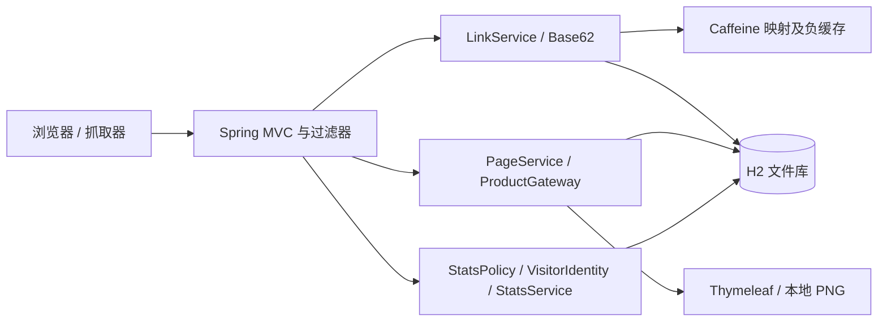

# 一物 · 商品短链与分享卡片

Java 17 + Spring Boot 3.5.7 的可运行 Demo。支持按商品、分享人和渠道创建短链，302 跳转，服务端 Open Graph 卡片，PV / UV 汇总，以及商品下架、删除和元数据缺失时的降级。

数据保存在本地 H2 文件中，缓存使用 Caffeine。不需要安装独立数据库、缓存服务或 Python。

## 启动

前提：安装 **JDK 17**，`java -version` 显示 17；首次运行可访问 Maven Central。提供 Maven Wrapper，自动下载 Maven 3.9.9，分发包有 SHA-256 校验。Windows 使用 PowerShell；macOS / Linux 需要 curl 或 wget。

从包含 `pom.xml` 的项目根目录执行（当前工作区的内层 `short-link/`）：

```powershell
# Windows PowerShell
.\mvnw.cmd spring-boot:run "-Dspring-boot.run.profiles=demo"
```

```bash
# macOS / Linux；通过 sh 调用，不依赖文件的可执行权限
sh ./mvnw spring-boot:run -Dspring-boot.run.profiles=demo
```

浏览器打开 [http://localhost:8080](http://localhost:8080)。服务只监听 `127.0.0.1`，在前台运行；Ctrl+C 停止。健康检查：`GET /actuator/health`，正常返回 `{"status":"UP"}`。

首次启动自动建立 `data/shortlink.mv.db` 并创建两个商品：1001 正常商品、1002 空标题和缺失图片商品。重启不会恢复已经删除的商品，也不会清空统计。不要同时启动两个实例访问同一个数据库文件；端口占用时先停止原实例。`data/` 不提交 Git，`mvn clean` 不会删除它。

## 测试与演示

### 直接通过页面演示（推荐）

启动后进入首页，点击右上角 **演示工作台**，或者打开 [工作台](http://localhost:8080/workbench)。已有服务需要先停止并重新启动，才能加载新代码。

1. 在商品 1001 / 1002 卡片点击「选此商品分享」，也可以使用生成表单中的商品下拉框切换。
2. 填写分享人、选择渠道，点击「生成分享链接」。可以复制短链/卡片链接、打开卡片或点击「访问商品」。
3. 在「看见分享的回响」点击「查询 / 刷新统计」，查看真实 PV / UV；支持日期、渠道、分享人、短链筛选及分组。结束日期包含当天，最多查询 31 天；历史列表显示最近 100 条。
4. 在商品卡操作标题、上下架、删除，通过「最近的分享」打开旧链接验证降级。删除后点击「恢复商品」，原短链和统计保留。
5. 点击「打开失效链接示例」查看友好错误页。需要清空数据时，在页面底部展开「重新开始演示」，确认后重置。

上述流程无需手工调用接口或修改地址参数。默认演示凭证自动连接；配置了 `DEMO_API_TOKEN` 时，在「访问凭证」弹窗输入自定义值。凭证仅在当前页面内存中保存，刷新后需重新输入，服务端实际凭证不写入页面。工作台及演示管理 API 只在 `demo` profile 可用。

工作台沿用服务端模板与原生 JavaScript，不需要安装 Node.js 或单独启动前端。微信平台的实际抓取和微信内分享仍需要公开可访问的部署及平台接入，不属于本地按钮演示范围。

### 自动化验收

另开一个终端，从同一个项目根目录执行：

```powershell
# 48 项自动测试（含两个各 10,000 次的属性测试）、格式检查、可执行 JAR 打包
.\mvnw.cmd -B verify

# 10 步真实 HTTP 演示：服务须已启动，会重置当前 Demo 数据
.\mvnw.cmd -B "-Dtest=DemoSmoke" test

# 停止并重新启动服务后，只验证持久化，不重置、不修改商品
.\mvnw.cmd -B "-Dtest=DemoSmoke" "-Ddemo.verifyOnly=true" test
```

macOS / Linux 将 `.\mvnw.cmd` 换成 `sh ./mvnw`。PowerShell 的 `-D...` 参数要保留引号。修改 Java 格式可执行 `sh ./mvnw spotless:apply`（Windows 用 `.\mvnw.cmd spotless:apply`），再运行 `verify`。

完整演示依次验证：创建与复用、OG 元数据和图片、302 与落地页、两位访客计数、HEAD/卡片不计数、跨渠道归因、友好 404、默认标题和图片、下架/删除降级、429 与 Retry-After。失败时退出码非零。

**演示结束后，商品 1001 被删除，统计为 PV=3、UV=2，这是异常演示的预期结果。** 首页仍提供该示例商品入口，访问时可看到友好错误页。需要恢复商品，在工作台点击「恢复商品」即可保留统计；需要清空所有数据时使用页面底部重置功能或受保护 reset 请求。重跑完整演示也会先 reset。普通 `verify` 不会执行 `DemoSmoke`，只访问独立内存测试库。

持久化验证从 `target/demo-state.json` 读取上一次演示的实际 key 和日期范围，因此要在 `clean` 之前执行。需要指定服务地址或令牌时添加 `"-Ddemo.baseUrl=http://localhost:8080"`，以及设置 `DEMO_API_TOKEN` 环境变量。

也可用打包产物运行：

```bash
java -jar target/short-link-demo.jar --spring.profiles.active=demo
```

## 接口示例

管理接口统一要求 `Authorization: Bearer demo-only-token`，这是 **Demo profile 的公开演示值**。API 返回 JSON；公开链接出错返回 HTML，不返回堆栈。完整可重放请求见 [requests/demo.http](requests/demo.http)（JetBrains HTTP Client 可自动生成日期和保存实际 key）。

Windows PowerShell 示例：

```powershell
$headers = @{ Authorization = 'Bearer demo-only-token' }
$body = '{"productId":1001,"sharerId":"user_001","channel":"wechat"}'
$link = Invoke-RestMethod -Method Post -Uri http://localhost:8080/api/links -Headers $headers -ContentType application/json -Body $body
$link
# 打开响应中的 shareUrl 预览，shortUrl 用于直接跳转
```

首次创建 201，重复三元组 200 且 `reused=true`，响应示例：

```json
{"key":"3SvxhBSGXAx","shortUrl":"http://localhost:8080/s/3SvxhBSGXAx","shareUrl":"http://localhost:8080/c/3SvxhBSGXAx","reused":false}
```

key 随机生成，不能复制示例值代替接口响应。`productId` 必须为正整数 JSON 数字，分享人匹配 `[A-Za-z0-9_-]{1,64}`，渠道只接受 `wechat / moments / other`。未知字段、小数 ID、错误类型均返回 400；请求体超过 8 KiB 返回 413。

| 请求 | 作用与主要状态 |
| --- | --- |
| `POST /api/links` | 创建 201、复用 200；商品不存在 404、下架 409 |
| `GET /s/{key}` | 302 跳转；无效 key 404、商品失效 410 |
| `HEAD /s/{key}` | 与 GET 相同导航状态，不记录访问、不签发 Cookie |
| `GET /c/{key}` | 分享卡片 HTML；商品失效仍 200 返回不可售文案 |
| `GET /products/{id}` | 模拟商品页，没有购买/支付功能 |
| `GET /media/products/{id}.png` | PNG；图片缺失或商品失效返回默认 PNG |
| `GET /api/stats?from=2026-11-17&to=2026-11-18&groupBy=channel,sharerId` | 指定日期与维度查询；需 Token |
| `PATCH /api/demo/products/1001` | `{"status":"OFF_SHELF"}` 或 `{"title":"新标题"}` |
| `DELETE /api/demo/products/1001` | 删除商品，旧短链保留 |
| `GET /api/demo/products` | 两件演示商品及删除占位，需 Token |
| `POST /api/demo/products/1001/restore` | 仅恢复缺失的种子商品，现存商品不覆盖，历史不清空 |
| `GET /api/demo/links` | 最近 100 条分享记录与实时商品状态，需 Token |
| `POST /api/demo/reset` | 清空短链和访问，恢复商品；仅供独占 Demo 演示 |

查询日期均必填，按香港时区解释，`from` 包含、`to` 不包含，最多 31 天。`groupBy` 可省略，或为 `channel`、`sharerId`、`channel,sharerId`；可追加 `key`、`channel`、`sharerId` 取交集过滤。超过 1000 个分组返回 422，需缩小范围。

恢复初始状态：

```powershell
Invoke-RestMethod -Method Post -Uri http://localhost:8080/api/demo/reset -Headers @{ Authorization = 'Bearer demo-only-token' }
```

不要在并发演示或需要保留现有统计时执行 reset。`/api/demo/**` 仅在 `demo` profile 注册。

## 架构和关键取舍



- 随机正 long → Base62，1–11 位、区分大小写、无前导零。编码解码互逆，解码不直接得到商品 ID。主键兜底碰撞，总计尝试最多 3 次；业务三元组唯一约束保证并发创建幂等。
- 302 配合 `Cache-Control: no-store`，每次都能观察商品状态并尝试计数。卡片入口 `/c` 不自动跳转、不计点击，用户点“查看商品”才访问 `/s`。
- Caffeine 最多 10,000 条，正缓存 5 分钟、缺失缓存 30 秒；原子加载合并相同 key 的并发查询，创建结果覆盖负缓存。商品状态不缓存；数据库失败不会缓存成“商品不存在”。
- SQL 参数绑定，模板自动转义，跳转目标由服务器生成；图片只读内置白名单资源。公开地址取配置，不信任 Host 或未经信任的代理头。
- 对非规范路径先拒绝；固定路由不接受百分号转义、matrix 参数及重复斜线别名，避免路由解释与鉴权解释不同。

## PV / UV 和反刷口径

PV 为**有效商品跳转尝试数**：在售商品、有效短链、GET、非已识别预览爬虫、通过限流，且同一访客与短链在同一 10 秒固定桶内未记录过。卡片、HEAD、404、410、429 都不计数；不保证浏览器实际完成商品页加载。

访客通过带 HMAC 签名的 UUID Cookie 标识（30 天、HttpOnly、SameSite=Lax；HTTPS 使用 Secure）。库中只存 UUID 的 HMAC，不存明文 Cookie 或 IP。数据库唯一约束保证并发刷新不重复插入。

UV 在查询范围内 `COUNT(DISTINCT visitor_hash)`，**不能累加各渠道、分享人或每日 UV 得到全局 UV**。清 Cookie、跨设备会增加 UV，多人共用浏览器会合并 UV；不是“真实人数”。固定桶跨边界可能短时间计两次，不是滑动窗口。

公开请求全局 100 次/秒（容量 200），单 IP 120 次/分钟（容量 30）；创建 30 次/分钟（容量 5）、统计 30 次/分钟（容量 10）。状态有界，仅限单实例。返回 429 与 `Retry-After`。无法彻底防止换 IP、清 Cookie 或伪造 UA；微信内置浏览器不会仅因包含 MicroMessenger 而被排除。

统计写入使用独立短事务，失败日志记为 `stats_write_failed`，仍返回 302；**尽力记录，不承诺零丢失**。商品或短链读取失败则 503，不误判成下架。SQL/锁等待设置约 1 秒，不宣称整个请求严格 1 秒内完成。

## 配置

| 环境变量 | Demo 默认值 / 用途 |
| --- | --- |
| `PORT` | `8080` |
| `PUBLIC_BASE_URL` | `http://localhost:8080`，必须为 HTTP(S) origin，用于 OG 绝对 URL |
| `DEMO_API_TOKEN` | `demo-only-token`，管理与统计接口 Token |
| `VISITOR_HMAC_SECRET` | Demo 固定演示密钥；非 Demo 模式必须显式设置至少 32 字符 |
| `DB_URL` | `jdbc:h2:file:./data/shortlink;LOCK_TIMEOUT=1000` |
| `DB_PASSWORD` | 本地默认空密码；无 H2 Web Console |

普通 profile 不提供默认 Token/密钥；必须配置后启动。更换访客密钥会改变统计去重身份。H2 文件只供单实例使用；未来换数据库应引入版本化迁移，不能依赖删除旧库升级结构。

## 已知限制与下一步

本地单实例，无账号体系；分享人是归因字段，不能当身份授权。静态首页为演示入口，不是实时商品推荐列表。没有真正接入电商商品源或微信 JS-SDK；Open Graph 抓取需要公网 HTTPS，微信实际展示与平台缓存需另外验证，第三方已缓存的卡片无法由本服务强制刷新。

数据量增加时，商品读取、同步写统计、范围聚合与连接池竞争是主要压力点。先用真实负载压测，再考虑 PostgreSQL、共享缓存/限流、商品变更事件、可靠事件队列与独立统计读模型。当前没有提供未经测量的 QPS 承诺。

## 工程记录

- [逐项需求核对与交付边界](docs/REQUIREMENTS_AUDIT.md)
- [原始方案与实施映射](DEMO_IMPLEMENTATION_PLAN.md)
- [实现决策与 AI 建议处理](docs/decisions.md)
- [独立审查与修复结论](docs/review.md)
- [故障定位记录](docs/troubleshooting.md)
- [验证结果及原始日志](docs/validation.md)
- [Prompt / 对话原文](docs/prompts/conversation.md)

本项目代码主要由 AI 辅助生成。仓库内保留实际需求变更、测试失败、审查发现与修复依据；面试讲解需要能解释约束、取舍和已知限制，不能仅展示“跑通”。
